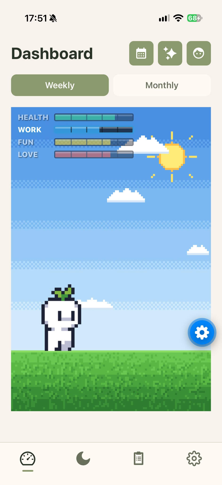

# H.W.P.L — Health, Work, Play, Love tracker

A local-first Expo wellbeing tracker for iOS and Android. Core app data is
stored in SQLite on-device; AI features use a configured backend.


<!-- 

 -->


## What's included

| Feature | Description |
|---|---|
| **Daily ratings** | Rate Health, Work, Play, and Love from 0 to 5, with an optional note. |
| **Items + notes** | Track tasks with optional deadlines, complete them, and keep separate notes tagged by category. |
| **Reports** | View weekly/monthly averages and a monthly rating calendar; optionally generate an AI summary. |
| **Characters** | Start as Basic, unlock Leafhead after rating on 3 days, and earn a random character pull every 7 rated days. Characters use the [Pixel Plains asset pack](https://snowhex.itch.io/pixel-plains). |
| **Astrology** | Save a birth chart, view the current moon and transits, and generate a monthly theme. |
| **Personalization + backup** | Set your name, theme, and font; use weekly automatic backups or import/export one in Settings. |
| **Notifications** | Get a daily rating reminder if no rating is logged, plus a Wednesday summary of outstanding items. |

## Running it

```bash
npm install
npm start
```

Open the project in Expo Go on a phone, or press `i` / `a` to launch an iOS or
Android simulator.

A few practical notes:

| Topic | Note |
|---|---|
| Database | Core app data uses local SQLite; no server is needed to run the app. |
| Backups | Manage automatic backups and import/export in Settings. |
| Notifications | Require a physical device and notification permission. |

## AI Summary

AI summaries and monthly astrology themes use the backend endpoints configured
in `ai/summarize.js` and `ai/monthlyTheme.js`; no LLM API key is shipped in the
app. Summary requests send the selected period's category averages, counts,
rating notes, and matching tagged notes. Theme requests send the natal chart,
placements, selected month, and transits.